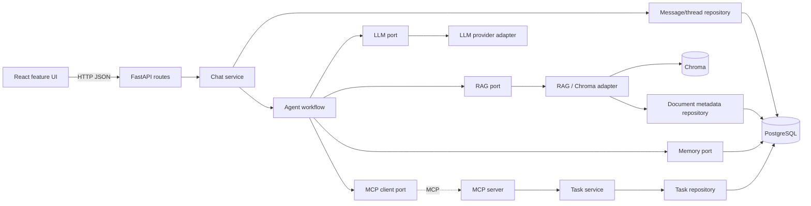

# ARYA — Architecture, Interfaces, and Team Guide

> **Current state:** the React frontend is a mockup. Theme selection, mobile navigation, and a UI-only notice work locally; chat sending, prompt suggestions, and other unfinished features are not connected. The backend tree is intentionally empty. This guide describes where future implementation belongs and how three people can integrate it safely.

## 1. Repository map

```text
ARYA/
├── frontend/
│   ├── index.html
│   ├── package.json
│   └── src/
│       ├── App.jsx                         # Composition root
│       ├── index.css                       # Global styles and theme tokens
│       ├── components/
│       │   ├── layout/                     # Sidebar, top bar, app shell, brand
│       │   ├── theme/                      # Theme preference hook
│       │   └── ui/                         # Shared presentation primitives
│       └── features/
│           └── chat/                       # Chat presentation, currently inert
├── backend/
│   ├── app/
│   │   ├── api/routes/                     # FastAPI route modules
│   │   ├── core/                           # Settings and app wiring
│   │   ├── services/                       # Application use cases
│   │   ├── db/
│   │   │   ├── models/                     # Persistence entities
│   │   │   ├── repositories/               # Persistence adapters
│   │   │   └── migrations/                 # Versioned schema changes
│   │   ├── rag/
│   │   │   ├── ingestion/                  # Load, validate, extract, chunk, index
│   │   │   └── retrieval/                  # Authorized retrieval and citations
│   │   ├── memory/                         # Explicit long-term preferences
│   │   ├── agent/                          # LangGraph state, nodes, graph
│   │   └── mcp/
│   │       ├── client/                     # Outbound MCP connection/adapters
│   │       ├── server/                     # Tool-server construction/lifecycle
│   │       └── tools/                      # Validated task tools
│   └── tests/
│       ├── unit/
│       └── integration/
├── docs/
│   ├── high-level-design.md                # System context and runtime workflows
│   └── architecture.md                     # This guide, interfaces and ownership
└── README.md
```

The backend folders contain only `.gitkeep` markers. Create modules as work is assigned; do not add placeholder functions that imply unfinished services are operational.

## 2. Runtime and dependency boundaries



### Dependency rules

1. The browser knows HTTP DTOs, not SQL schemas, LangGraph state, or MCP protocol details.
2. Route handlers translate HTTP into service calls; they do not implement use cases or write SQL.
3. Services orchestrate work and depend on narrow interfaces.
4. Repositories own database queries and transaction behavior.
5. RAG, LLM, and MCP integrations are adapters at the boundaries.
6. Agent nodes use injected ports; they do not open database connections or reach into UI code.
7. The MCP server calls task services; tool functions do not contain model-authored SQL.

## 3. Proposed API and shared data contracts

These contracts are starting proposals for team discussion, not implemented endpoints.

### Health

`GET /api/health`

```json
{ "status": "ok" }
```

Keep liveness minimal. Add readiness/dependency checks when the team decides how those checks should behave.

### Send a chat message

`POST /api/v1/chat/threads/{thread_id}/messages`

Request:

```json
{
  "message": "Explain process and thread differences using my notes.",
  "client_message_id": "optional-id-for-retry-safety"
}
```

Response:

```json
{
  "thread_id": "thread-id",
  "user_message": {
    "id": "message-id",
    "role": "user",
    "content": "Explain process and thread differences using my notes."
  },
  "assistant_message": {
    "id": "message-id",
    "role": "assistant",
    "content": "A process ...",
    "sources": [
      {
        "document_id": "document-id",
        "title": "Operating Systems Notes",
        "chunk_id": "chunk-id",
        "excerpt": "Relevant text ...",
        "page": 4
      }
    ],
    "actions": []
  }
}
```

`sources` and `actions` are empty arrays when not applicable. A citation must refer to a retrieved source, not an invented reference.

### Read chat history

`GET /api/v1/chat/threads/{thread_id}/messages`

Return messages in chronological order, scoped by both the resolved user and thread. A caller-supplied user identifier is not authentication. For an early local-only API, document a development identity explicitly and replace it with real authentication before any shared deployment.

### Error shape

Use a consistent non-success response. Example:

```json
{
  "error": {
    "code": "DOCUMENT_NOT_READY",
    "message": "This document is not ready for search.",
    "request_id": "optional-request-id"
  }
}
```

Do not return an empty answer or a fabricated successful tool result when a dependency fails.

### Shared domain shapes

```text
ChatMessage:
  id: string
  thread_id: string
  role: "user" | "assistant"
  content: string
  created_at: ISO-8601 timestamp
  sources: SourceCitation[]

SourceCitation:
  document_id: string
  title: string
  chunk_id: string
  excerpt: string
  page: integer | null

AgentRequest:
  user_id: string
  thread_id: string
  message: string

AgentResponse:
  content: string
  sources: SourceCitation[]
  actions: ActionSummary[]
```

The chat service passes explicit user and thread scope into every repository and capability call.

## 4. Internal capability contracts

### RAG

```text
ingest_document(user_id, document_id, file) -> IngestionResult
retrieve(user_id, query, filters?) -> list[RetrievedChunk]
```

`RetrievedChunk` contains text, document ID/title, chunk ID, and page/section when available. Retrieval verifies document ownership and applies verified document IDs as filters. Index writes should be repeatable for a document so re-ingestion does not accumulate stale duplicate chunks.

### Memory

```text
save_memory(user_id, kind, content, source?) -> MemoryRecord
search_memories(user_id, query, limit) -> list[MemoryRecord]
```

Memory is separate from chat history. Define how a memory is created, edited, removed, and sourced before allowing automatic memory writes. Every lookup is user-scoped.

### Persistence

```text
append_message(user_id, thread_id, role, content, metadata) -> ChatMessage
list_messages(user_id, thread_id, limit, cursor?) -> list[ChatMessage]
get_owned_document_ids(user_id, filters?) -> list[DocumentId]
create_task(user_id, validated_task_input) -> Task
list_tasks(user_id, filters?) -> list[Task]
complete_task(user_id, task_id) -> Task
```

These are behavioral contracts, not prescribed ORM methods. Person 2 chooses schema, migrations, transaction/session lifecycle, and implementation; consumers must not depend on those details.

### MCP tools

Initial candidate tools:

- `create_revision_task(title, due_at?, document_id?)`
- `list_revision_tasks(status?, limit?)`
- `complete_revision_task(task_id)`

Validate inputs, scope every task to its owner, bound result sizes, and return structured success/error results. Require explicit user confirmation for destructive operations. Keep tools narrow and call the task service/repository rather than issuing generated SQL.

### Frontend API client

The chat feature should depend on a small client interface when the API is implemented:

```text
sendMessage({ threadId, message }) -> Promise<ChatTurn>
getThreadMessages({ threadId }) -> Promise<ChatMessage[]>
```

Keep HTTP base URL, serialization, and response/error parsing in the API client. Keep loading/error state in the chat feature hook and rendering in components. Replace the mock-disabled controls only when the matching behavior and tests are ready.

## 5. Three-person ownership and handoff

### Person 1 — frontend and RAG

**Owns:** `frontend/`, `backend/app/rag/`, related RAG tests.

- Maintain the visual system and responsive layout.
- Agree on chat DTOs with the shared API before wiring the UI.
- Implement format validation, ingestion, chunking, indexing, retrieval, and source references incrementally.
- Provide mocked/replaceable embedding and vector-store boundaries in unit tests.
- Do not access PostgreSQL directly from frontend or RAG UI components.

### Person 2 — database and memory

**Owns:** `backend/app/db/`, `backend/app/memory/`, migrations, persistence tests.

- Choose the SQL toolkit and migration workflow in the first persistence issue.
- Own PostgreSQL setup, schema, indexes, repositories, and transaction boundaries.
- Establish user/thread/document/task isolation at the repository layer.
- Define explicit memory lifecycle and retrieval tests.
- Publish stable contracts; do not require other teammates to depend on ORM entities or open their own DB connections.

### Person 3 — MCP and agent

**Owns:** `backend/app/mcp/`, `backend/app/agent/`, agent/MCP tests.

- Implement server/client as separate modules and tool functions as narrow units.
- Route only to required capabilities; model output does not authorize a database operation.
- Obtain confirmation before destructive actions.
- Mock RAG, memory, model, and MCP ports for unit tests; isolate network/provider tests.

### Shared integration work

- Each meaningful task has a GitHub issue, owner, acceptance criteria, and feature branch.
- Agree on interface changes in this document before a consumer hard-codes assumptions.
- Open small pull requests and request a teammate review.
- Add tests with the feature; run focused tests and frontend checks before merge.
- Keep `main` runnable and update docs/status honestly.

## 6. Test strategy

| Layer | What to test | External dependencies |
|---|---|---|
| UI components | Layout, disabled/enabled state, accessible controls, errors | None |
| Frontend API client | DTO mapping, non-2xx errors, timeout/connection behavior | Mock HTTP |
| API routes | Validation, status codes, user context, serialization | Dependency overrides |
| Services | Workflow order, persistence calls, failure propagation | Fake repositories/adapters |
| Repositories | Ownership filters, queries, transactions | Test PostgreSQL or isolated DB fixture |
| RAG | File validation, chunk metadata, filters, citations | Fake embedder/vector store; separate integration test |
| Memory | User scoping, save/search/delete lifecycle | Fake or test repository |
| MCP tools | Input validation, ownership, idempotency, structured errors | Fake task service |
| Agent | Correct routing and no unnecessary tool calls | Fake model and capability ports |
| End to end | UI/API/history and one grounded-answer path | Local test stack; provider may be stubbed |

Tests should not need a real model API key by default. Keep provider smoke tests opt-in and document the required configuration.

## 7. Security and operational boundaries

- Never commit `.env`, API keys, virtual environments, databases, Chroma data, generated files, or private study documents.
- Accept only documented file formats and enforce upload size limits before parsing.
- Treat uploaded text as untrusted input; do not interpret it as instructions to access other resources.
- Enforce user authorization in API/service/repository/tool code, not prompts.
- Use parameterized queries through the selected database library; do not expose arbitrary SQL tools.
- Make destructive task operations explicit and auditable.
- Configure timeouts and explicit error handling for LLM, Chroma, database, and MCP calls.
- Record useful operational errors without logging credentials or full private document content.

## 8. Implementation order

1. Confirm the ownership split and agree on the API/domain contracts above.
2. Create a minimal backend package, settings, FastAPI app, health endpoint, and tests.
3. Implement PostgreSQL migrations/repositories and chat history before adding orchestration.
4. Add a basic chat service boundary and mocked response test; keep model integration optional.
5. Build RAG ingestion/retrieval and citations as an independent module.
6. Add memory and MCP task operations behind tested contracts.
7. Add the LangGraph workflow only when capability adapters are callable and testable.
8. Connect UI controls one at a time and add integration tests.

At each step, remove “coming soon” or disabled UI only after that feature is actually implemented. This keeps the starter honest and gives the team a visible progression from mockup to working app.
