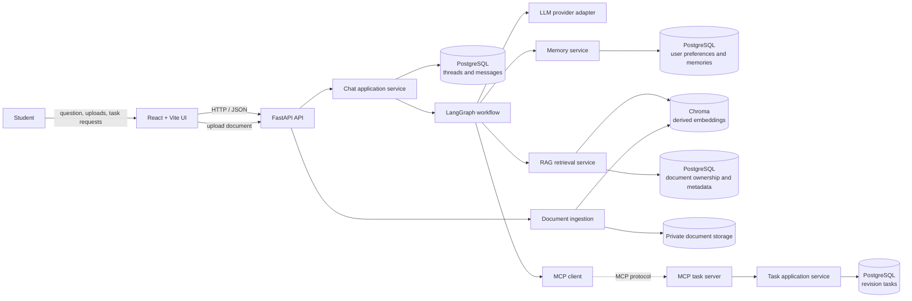
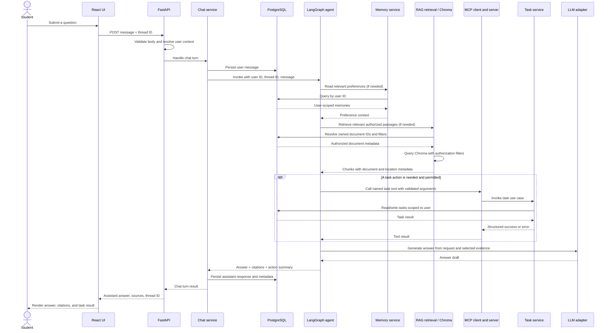
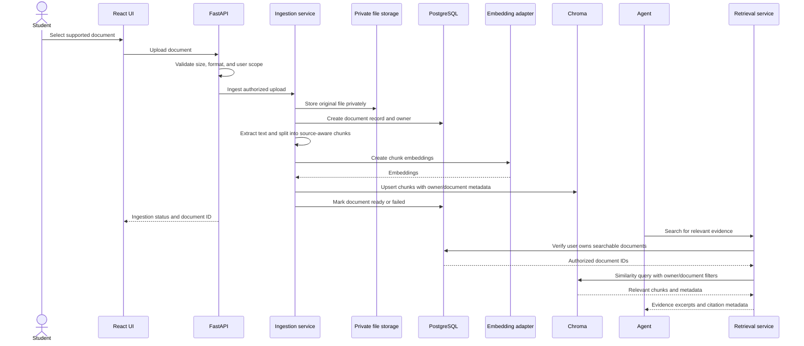

# ARYA — High-Level Design

> **Document status:** proposed target design. The repository currently provides a React UI mockup and empty backend work areas. The API, database, RAG, memory, MCP, and agent described below are not implemented yet.

## 1. Product direction

ARYA is a three-person learning project for a study companion. A student should be able to ask questions about their learning material, receive grounded answers with source references, keep useful study preferences between sessions, and manage revision tasks through safe, explicit tools.

The goal is not to connect every technology on day one. The team should build the smallest testable increment, agree on boundaries before parallel work, and keep `main` understandable and runnable.

### First useful end-to-end outcome

1. The student opens the React chat and asks a question.
2. FastAPI validates the request and associates it with a user and conversation thread.
3. The application stores the user message.
4. A basic assistant workflow returns an answer.
5. The application stores and displays the answer.

Document citations, long-term memory, MCP tasks, and advanced agent routing are later increments. This order gives the team a working vertical slice before adding optional subsystems.

## 2. Goals and non-goals

### Goals

- A clean React + Vite interface and Python + FastAPI service.
- PostgreSQL as the source of truth for transactional application data.
- Independent, testable RAG ingestion and retrieval modules with source metadata.
- User-scoped conversation history and explicit persistent memory.
- Narrow, input-validated MCP task tools.
- LangGraph orchestration that calls only capabilities needed for a request.
- Three teammates able to work in separate areas against agreed contracts.

### Non-goals for the learning scaffold

- Production identity, billing, enterprise administration, or a public multi-tenant launch.
- Letting a model execute arbitrary SQL or unrestricted filesystem operations.
- Adding all AI dependencies before their owning feature is ready.
- Treating model-generated text as verified fact.
- Building autonomous, irreversible actions without user confirmation.

## 3. System context

The browser communicates only with FastAPI. Database connections, provider credentials, Chroma access, private documents, and MCP server connections remain on the backend.

## 4. Component responsibilities

| Component | Responsibility | Initial owner |
|---|---|---|
| React UI | Chat experience, upload status, sources, task feedback, theme and navigation | Person 1 |
| FastAPI routes | HTTP validation, user/thread context, request/response mapping | Shared integration |
| Chat service | Coordinate message persistence and one agent turn | Shared integration |
| PostgreSQL repositories | Persist threads, messages, documents, memories, and tasks | Person 2 |
| RAG ingestion | Validate supported files, extract text, chunk, embed, and index | Person 1 |
| RAG retrieval | Search only authorized documents and return source-aware chunks | Person 1 |
| Memory service | Store and retrieve explicit, user-scoped preferences | Person 2 |
| LangGraph workflow | Route to retrieval, memory, tools, and model using typed boundaries | Person 3 |
| MCP server/tools | Provide narrowly scoped, validated revision-task actions | Person 3 |
| MCP client | Connect the agent to the configured tool server and normalize results | Person 3 |
| LLM adapter | Encapsulate model configuration, calls, and provider errors | Person 3 |

## 5. Main chat sequence

The agent does not call every service for every prompt. A general concept question may need only the model; a question about uploaded notes may use RAG; a request to schedule study work may use an MCP task tool. A tool failure or retrieval failure must be surfaced honestly rather than replaced with a success-shaped response.

## 6. Document ingestion and retrieval sequence

Store enough metadata on each chunk to identify its document, chunk, and page/section when available. Chroma is a derived search index, not the authority for ownership or the original document.

## 7. Data ownership and source of truth

| Data | System of record | Notes |
|---|---|---|
| Threads and chat messages | PostgreSQL | Canonical conversation history; always query by user and thread |
| Document ownership and status | PostgreSQL | Authoritative ACL and ingestion lifecycle |
| Original document bytes | Private local storage initially | Never commit private study material |
| Document chunks and embeddings | Chroma | Derived/rebuildable; filter by verified owner and document IDs |
| User preferences and long-term memories | PostgreSQL | Store explicit useful memory separately from raw chat logs |
| Revision tasks | PostgreSQL | Mutations occur through validated task use cases |
| In-progress agent execution state | LangGraph checkpointer | Complements chat history; select a persistence backend deliberately |

Every resource lookup must include its user/owner scope. Prompt text is not an authorization mechanism.

## 8. Quality, safety, and failure behavior

- Validate HTTP, upload, repository, and MCP input at the receiving boundary.
- Do not allow arbitrary SQL generated by the model.
- Keep model, database, and MCP credentials in backend environment configuration.
- Require confirmation for destructive actions; make task completion idempotent where feasible.
- Return source citations only when retrieval actually supplied them.
- Clearly distinguish model answers, retrieved evidence, and completed tool actions.
- If a required dependency fails, report an error or a clearly limited response; never claim a tool action succeeded when it did not.
- Test logic with fakes/mocks before running tests against external model or vector services.
- Add migrations when the first persistent schema is introduced.
- Keep user-uploaded documents, `.env`, databases, virtual environments, and generated files out of Git.

## 9. Phased roadmap and completion checks

| Phase | Scope | Done when |
|---|---|---|
| 0. Shared foundation | Keep UI starter, choose Python package/test approach, agree API types, add backend app skeleton and CI | Clean clone can install/run UI; backend health check and tests run without secrets |
| 1. Chat + PostgreSQL | Thread/message schema, migrations, repositories, chat endpoints and history | API tests prove user/thread isolation and message persistence |
| 2. Document RAG | Supported upload formats, extraction, chunking, indexing, retrieval, citations | Tests cover ingestion errors, retrieval results, source metadata, and owner filtering |
| 3. Memory | Explicit preference/memory API, storage and retrieval | A permitted memory survives restart and remains isolated per user |
| 4. MCP task tools | Task schema and repository, server tools, client adapter, confirmation behavior | Tool tests cover valid/invalid input, ownership, idempotency, and errors |
| 5. Agent workflow | LangGraph state, routing, capability adapters, checkpointing | Mocked workflow tests prove only necessary capabilities are called |
| 6. UI integration | Replace disabled controls with API-backed behavior; render citations/status/errors | Browser/API integration tests exercise a complete student query |

Only include dependencies that the current phase needs. Merge each phase as a reviewed, understandable increment.
